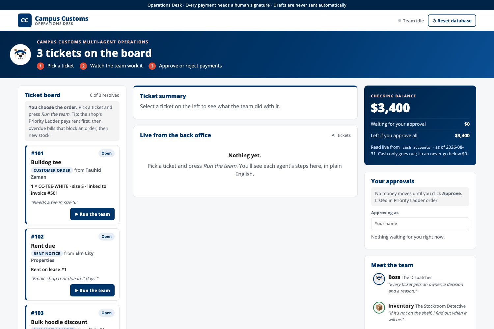
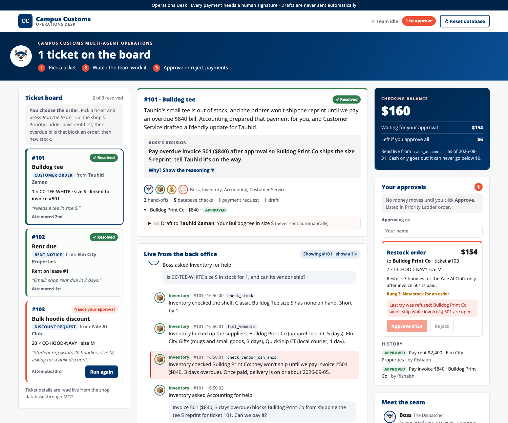
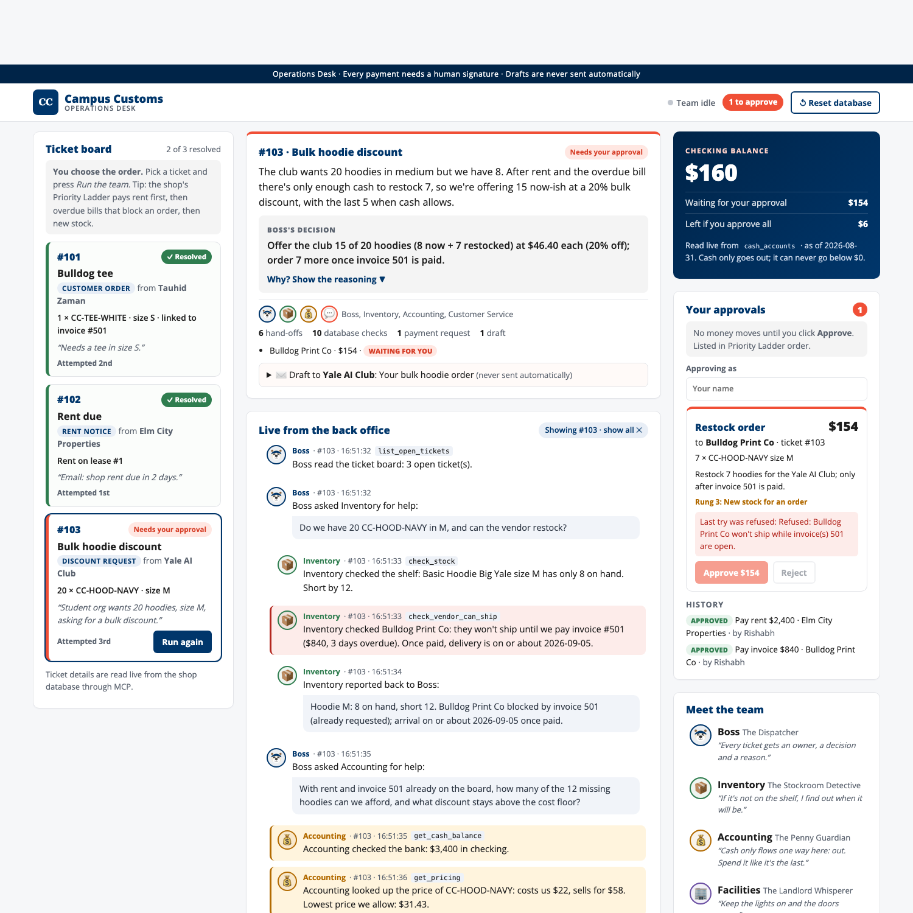

# Campus Customs Operations Desk: Dashboard Design

The dashboard (`frontend/`, React + Vite + TypeScript) is where a human watches the agent team work the ticket board and signs off on any money that leaves the shop. It is built for a shop manager, not an engineer: everything is in plain English, money is always in view, and nothing is paid without a click.

**How it connects:** the page runs at `http://localhost:5173` (`npm run dev`) and the browser calls the FastAPI backend directly at `http://localhost:8000` (`frontend/src/api.ts`). The backend's CORS settings allow exactly the Vite origin (`http://localhost:5173` and `http://127.0.0.1:5173`), so the browser may call the routes; any other website is refused. The dashboard polls `GET /api/events` every 1.5 s while a run is going (every 5 s when idle) and refreshes tickets, approvals and cash whenever something changes.



---

## 1. Theme

It matches the Campus Customs shop website from HW4, so it feels like part of the same business:

| Element | Choice |
|---|---|
| Colours | Yale navy `#00366b` (structure, headings, the Boss), coral `#f04f36` (anything that needs *you*: approvals, the "to approve" pill), green `#2f7d4f` (done / resolved), amber (money), red (safety stops) |
| Type | Open Sans, with heavy weights for numbers and headings |
| Brand | The "CC" mark, "Campus Customs · Operations Desk", and Handsome Dan the bulldog as the Boss's face |
| Header | Navy announcement bar with the two promises that matter most: *"Every payment needs a human signature · Drafts are never sent automatically"* |

---

## 2. Layout

```
┌──────────────────────────────────────────────────────────────────────────┐
│ Announcement bar · CC Campus Customs, Operations Desk                     │
│   status: ● Team working / idle · [N to approve] · [↺ Reset database]     │
├──────────────────────────────────────────────────────────────────────────┤
│ Hero: Handsome Dan · "3 tickets on the board" · ① Pick ② Watch ③ Approve │
├──────────────┬──────────────────────────────────────┬────────────────────┤
│ TICKET BOARD │ TICKET SUMMARY (selected ticket)      │ CHECKING BALANCE   │
│  #101 card   │  plain-English summary, decision,     │  $3,400            │
│  #102 card   │  "Why?", who worked it, counts        │  waiting / left    │
│  #103 card   ├──────────────────────────────────────┤────────────────────┤
│  ▶ Run each  │ LIVE FROM THE BACK OFFICE             │ YOUR APPROVALS     │
│              │  step-by-step feed, newest at bottom  │  Approve / Reject  │
│              │                                       ├────────────────────┤
│              │                                       │ MEET THE TEAM      │
└──────────────┴──────────────────────────────────────┴────────────────────┘
```

The page reads **left → centre → right**, which follows the job itself: **choose → watch → decide**.

- **Left, the Ticket board:** the three tickets and the only "start" buttons on the page. You pick the order; each card then says *Attempted 1st / 2nd / 3rd*. A hint explains the Priority Ladder (rent, then overdue bills that block an order, then new stock) without forcing it.
- **Centre, the story:** the **Ticket summary** for the selected ticket sits above the **live feed**, so the outcome is always the first thing you read and the detail is underneath. Clicking a ticket filters the feed to that ticket ("Showing #103 · show all ✕").
- **Right, money and people:** the **Checking balance**, then **Your approvals**, then **Meet the team**. Money stays on screen however far you scroll the feed.
- The side columns are sticky, and the feed scrolls inside its own box, so new steps never push the page around.
- On narrower screens it drops to two columns (feed full-width underneath), and on phones to one.

---

## 3. How the agents read differently

Every event from the backend is turned into **one plain-English sentence** (`frontend/src/narrate.ts`) instead of raw JSON. Each agent has its own **face, colour and voice**, taken from its prompt:

| Agent | Avatar | Colour | Motto shown in "Meet the team" |
|---|---|---|---|
| Boss, "The Dispatcher" | Handsome Dan 🐶 | navy | *"Every ticket gets an owner, a decision and a reason."* |
| Inventory, "The Stockroom Detective" | 📦 | green | *"If it's not on the shelf, I find out when it will be."* |
| Accounting, "The Penny Guardian" | 💰 | amber | *"Cash only flows one way here: out. Spend it like it's the last."* |
| Facilities, "The Landlord Whisperer" | 🏢 | purple | *"Keep the lights on and the doors open."* |
| Customer Service, "The Bulldog Voice" | 💬 | coral | *"Honest dates, warm words, no surprises."* |

**What a feed line looks like:**

- **Who, where, when:** avatar, coloured name, ticket number, time, and the tool used (e.g. `check_stock`) as a small grey tag for anyone who wants the detail.
- **What they did:** tool results become sentences, e.g.
  - `check_stock` → "Inventory checked the shelf: Classic Bulldog Tee size S has none on hand. Short by 1."
  - `check_vendor_can_ship` → "Inventory checked Bulldog Print Co: they won't ship until we pay invoice #501 ($840, 3 days overdue). Once paid, delivery is on or about 2026-09-05."
  - `get_cash_balance` → "Accounting checked the bank: $3,400 in checking."
  - `get_lease` → "Facilities checked the lease: $2,400 rent to Elm City Properties, due 2026-09-02 (2 days away)."
- **What they said:** hand-offs and reports appear as **speech bubbles**: "Boss asked Inventory for help: *'Do we have 20 CC-HOOD-NAVY in M…'*" and "Inventory reported back to Boss: *'…'*".
- **Who asked whom:** each hand-off is **indented one step** (Boss → Inventory → Accounting), so the chain of delegation is visible at a glance.
- **Tone colours**, so the feed can be skimmed:
  - **amber:** money steps (cash checks, prices, payment requests);
  - **red:** safety stops, e.g. "A safety rule stopped Accounting: …", or a blocked vendor;
  - **green:** decisions and resolutions;
  - **coral:** your own actions ("Rishabh approved request #2…").
- **Who's working right now:** while a run is going, a "The team is working…" indicator bounces at the bottom of the feed, the header dot turns green, and the active agent glows in **Meet the team**.

---

## 4. How resolved tickets show up

Each ticket card has a **coloured left edge and a status badge** that follow it through its life:

| State | Badge | Card edge | When |
|---|---|---|---|
| Open | navy "Open" | navy | not worked yet |
| Working | green "Team working…" | green | a run on this ticket is in progress |
| Needs you | coral "Needs your approval" | coral | the Boss decided, but a payment is waiting for you |
| Blocked | red "Blocked" | red | the Boss couldn't finish without a human decision |
| **Resolved** | solid green **"✓ Resolved"** | green, with a pale green card | done |

**What makes a ticket resolved:** the backend marks it resolved **through MCP `resolve_ticket`** (with the Boss's decision and summary written on the ticket as the reason) as soon as nothing is left for a human. That means the Boss has decided, the ticket isn't blocked, and **every payment, discount and customer message** for it is approved. So #102 turns green the moment you approve the rent, and #101 once you've approved both invoice 501 and the message to Tauhid. Anything pending or rejected keeps the ticket open, so you can run the team again.

When a ticket is resolved:
- the **Run** button disappears;
- the hero counts down ("1 ticket on the board", then "All tickets resolved. Nice work!");
- "N of 3 resolved" updates on the board;
- the **Ticket summary** shows a green top border with the Boss's plain-English summary, the decision, a **"Why? Show the reasoning"** toggle (reasoning plus each fact with its source), who worked on it (avatars), and counts of hand-offs, database checks, payment requests and drafts;
- any customer message appears as a ✉️ draft that is clearly labelled *never sent automatically*.



---

## 5. How cash flow shows up

Money is the one thing the human must never lose track of, so it gets the strongest visual on the page: a **navy card at the top right** with the balance in large type.

- **Checking balance:** read live from `cash_accounts` through MCP (`GET /api/cash`), with its "as of" date. It is never calculated in the browser.
- **Waiting for your approval:** the total of pending payment requests.
- **Left if you approve all:** balance minus pending. It turns red if it would go below $0, so you can see before you click that the plan doesn't fit.
- **When a payment goes through,** the balance drops and a coral **"−$840 paid just now"** flash appears for a few seconds, with a ring around the card, so the drop is impossible to miss. In the demo run: $3,400 → $1,000 (rent) → $160 (invoice 501).

**Approvals are where cash leaves.** Each pending request is a card in **Priority Ladder order**:
- the card shows the kind (Pay rent / Pay invoice / Restock order), the amount in large type, the payee, the ticket, the reason and its ladder rung ("Rung 1: Rent");
- **Approve $X** (coral) and **Reject** buttons, which stay disabled until you type your name in "Approving as", because the name is recorded as `approved_by` in the `payments` table;
- if the shop's rules refuse a payment, the card says why and stays pending. For example, approving the hoodie order before invoice 501: "Last try was refused: Bulldog Print Co won't ship while invoice(s) 501 are open." Nothing is paid;
- **discounts** wait here as amber-topped 🏷️ cards ("10% off · 12 × CC-HOOD-NAVY: $58 → $52.20 · margin 57.9%"), with **Approve discount** / **Reject**. No money moves; a discount only sets the price offered;
- **customer messages** also wait here as navy-topped cards showing the full text, with **Approve message** / **Reject**. Approving marks the draft ready; it is never sent;
- **dependencies are visible:** a restock order that needs another payment first shows "⏳ Approve first: Pay invoice $840 to Bulldog Print Co", and its Approve button stays locked until then;
- approved and rejected payments and messages move to **History** with green or red pills and who approved them.

The header also shows a coral **"N to approve"** pill, so pending money is visible even while you're reading the feed.



---

## 6. Usability details

- **One clear action per area:** Run (left), Approve/Reject (right). Everything in the middle is read-only.
- **Safe by default:** Run buttons lock while a run is going, Reset asks for confirmation, and approvals need a name.
- **Feedback for every click:** green toasts for success and red for problems ("Payment refused: …", "Could not reach the backend at http://localhost:8000").
- **Empty states explain what to do next:** "Nothing yet. Pick a ticket and press Run the team…", "Nothing waiting for you right now."
- **Reset database** (header) puts the shop back to its original values for a fresh run; the audit trail is kept.

*Screenshots 2 and 3 come from a scripted demo run of the real backend (scripted model, no tokens), taken with headless Chrome. The database was reset afterwards.*
